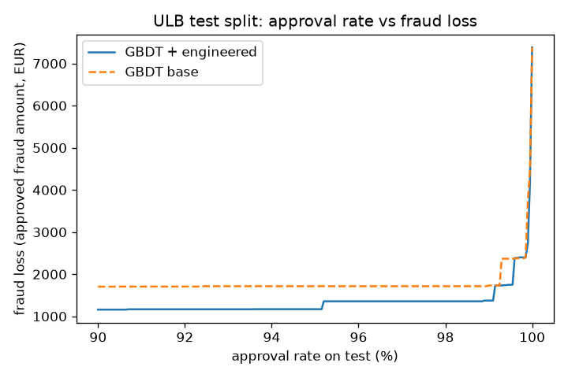

# payments-risk-routing-lab

**Learning project (OSS, not production, not affiliated with any employer).** Fraud scoring on a real
public card-fraud dataset with leakage-safe, time-split, high-cardinality features, approval-rate vs
fraud-loss threshold analysis, a contextual-bandit acquirer router evaluated offline on **simulated**
acquirer outcomes, and a FastAPI scoring endpoint with measured latency.

## Dataset (and why not IEEE-CIS)

IEEE-CIS needs a Kaggle login and none was available, so this repo uses the **ULB / Worldline
"Credit Card Fraud Detection"** dataset (284,807 European card transactions over 2 days, 492 frauds,
0.17%). It is downloaded from the public TensorFlow mirror and **pinned by SHA-256**
(`76274b69…51a89`, see `prrl/data.py`). The CSV is not committed.

Big caveat: ULB has only `Time`, `Amount` and 28 anonymised PCA components (`V1..V28`). **It has no
card, customer, merchant or device IDs.** So the "high-cardinality" keys here are derived proxies:

| key | derivation | cardinality | what it is NOT |
|---|---|---|---|
| `amt_key` | exact amount in cents | 32,767 distinct | not a merchant or card ID |
| `vbin_key` | train-fitted deciles of V1..V4, combined | 6,680 cells seen in train | not a customer/device ID |

## Pipeline

- **Time split** (no shuffling): first 60% of rows by `Time` = train (360 frauds), next 20% = valid (57), last 20% = test (75).
- **Velocity**: count of earlier transactions with the same key in the last 1h / 24h, plus global 1h traffic. Backward-only and label-free (`prrl/features.py::velocity`).
- **Frequency encoding**: key counts fitted on train only; unseen → 0.
- **Target encoding, time-respecting**: on train, each row sees only labels of *earlier* rows with the same key (expanding, smoothed, current row excluded). For valid/test/serving, stats are frozen at the end of train, i.e. we assume post-train labels haven't arrived yet (chargeback delay). Tests check that changing a future label never changes an earlier encoding.
- **Model**: sklearn `HistGradientBoostingClassifier` (300 iters, lr 0.05), base features (`V1..V28`, `Amount`, hour) vs base + engineered.
- **Serving parity**: the API recomputes the same features online (in-memory per-key history); a test asserts online features equal the offline ones.

## Results (real, on the ULB test split; `results/metrics.json`)

| model | test PR-AUC | test ROC-AUC |
|---|---|---|
| GBDT base features | **0.810** | 0.983 |
| + velocity only | 0.799 | 0.983 |
| + frequency only | 0.796 | 0.985 |
| + target encoding only | 0.792 | 0.987 |
| + all engineered | 0.787 | 0.986 |

**The engineered features did not help.** Bootstrap PR-AUC difference (all engineered − base) is
−0.022, 95% CI [−0.048, +0.000]. The most likely reason is that the proxy keys aren't real entities,
so "velocity" is not card velocity. With only 75 test frauds, these PR-AUCs are also noisy. On a dataset
with real card/device IDs (such as IEEE-CIS), these features are where most of the lift usually comes from;
this repo shows the leakage-safe *mechanics*, not that lift.

### Approval rate vs fraud loss (amount weighted)

Thresholds were chosen on **valid** score quantiles and applied to **test**. Total fraud amount on test is €7,729.

| target approval (valid) | test approval | fraud loss € | loss share | frauds caught /75 | false declines | false-decline € |
|---|---|---|---|---|---|---|
| 95.0% | 94.20% | 1,171 | 15.1% | 68 | 3,237 | 718,115 |
| 98.0% | 97.62% | 1,358 | 17.6% | 67 | 1,289 | 333,645 |
| 99.0% | 98.81% | 1,358 | 17.6% | 67 | 612 | 192,726 |
| 99.5% | 99.38% | 1,740 | 22.5% | 64 | 291 | 121,304 |
| 99.8% | 99.77% | 2,401 | 31.1% | 58 | 73 | 51,699 |
| 99.9% | 99.87% | 2,643 | 34.2% | 56 | 16 | 30,874 |
| 99.95% | 99.94% | 4,146 | 53.6% | 35 | 0 | 0 |



Takeaway: the false-decline amount is far larger than the fraud saved at aggressive thresholds, so the
choice depends on margin and chargeback costs, which this dataset doesn't include.

### Acquirer routing: contextual bandit (SIMULATED outcomes)

> **Everything about the acquirers is simulated.** There are 3 made-up acquirers, each with a toy
> logistic authorisation model (P(approve | context)) and a made-up fee. The context comes from real
> test transactions (log amount, the GBDT fraud score, a 4-way segment from `vbin_key`). Reward =
> approved × (1 − 10·fee). The simulator was tuned so that the best acquirer depends on context.

Logging policy: uniform random routing over the 56,962 test transactions. Evaluation uses Li et al. replay
(unbiased under uniform logging), plus IPS with a 95% CI for the static policy. The best static acquirer
was chosen by IPS on the valid logs.

| policy | replay value | true expected reward (sim known) |
|---|---|---|
| random | 0.499 | 0.502 |
| best static acquirer | 0.641 (IPS 0.644, CI 0.634–0.653) | 0.641 |
| **LinUCB** (α=0.5, learns online during replay) | **0.675** | 0.680 (final policy, frozen) |
| oracle | – | 0.682 |

The router's lift over a static choice exists only because the simulator was built with
context-dependent acquirers. It says nothing about real acquirer behaviour.

### Scoring API latency (`results/api_latency*.json`)

`uvicorn prrl.api:create_app --factory`, 1 worker, `OMP_NUM_THREADS=1`, on an 8-vCPU shared box
(load average ~5 from other jobs at the time). Requests are 4,000 real test rows, after a 200-request warm-up.

| concurrency | p50 | p95 | p99 | throughput | errors |
|---|---|---|---|---|---|
| 1 | 3.8 ms | 5.0 ms | 5.3 ms | 252 rps | 0 |
| 20 | 67 ms | 91 ms | 103 ms | ~300 rps | 0 |

At concurrency 20 the time is almost entirely queueing, because a single process saturates at about 300 rps.
An earlier pandas-based feature path ran at about 45 rps; switching to a dict/numpy fast path fixed it.

## Real vs stubbed

| part | status |
|---|---|
| Fraud dataset, labels, amounts, time order | **real** (ULB, checksum pinned) |
| Card/merchant/device IDs | **absent**; proxy keys derived (see table) |
| Time split, velocity, frequency and target encoding, GBDT, metrics | **real** |
| Threshold / fraud-loss analysis | **real** amounts; no fees, margins or chargeback costs |
| Acquirers, auth outcomes, fees, logging policy | **simulated** |
| LinUCB, replay and IPS estimators | real implementations, run on simulated logs |
| FastAPI endpoint and latency numbers | **real**, measured on one shared machine; online state is in-memory and single-process |

## Limits

- ULB is 2 days of 2013 European card data with PCA-anonymised features; it isn't Solidgate-like or IEEE-CIS-like.
- There are no real entity IDs, so velocity and encoding features are proxies, and they didn't improve PR-AUC.
- Only 75 test frauds, so metric CIs are wide. Single model seed, no hyperparameter search.
- Target encoding assumes no labels arrive after train; a real system would model label delay.
- Bandit results depend entirely on the toy simulator.
- Latency comes from one uvicorn worker on a shared, loaded box, with no network hop and no persistence for velocity state.

## Run it

```bash
python -m venv .venv && . .venv/bin/activate && pip install -r requirements.txt
PYTHONPATH=. pytest -q                              # offline unit tests on synthetic fixtures
PYTHONPATH=. python scripts/run_experiment.py       # downloads data (~150 MB), ~1-2 min
PYTHONPATH=. python scripts/bench_api.py            # CONC=20 N=4000 by default
```

License: MIT.
